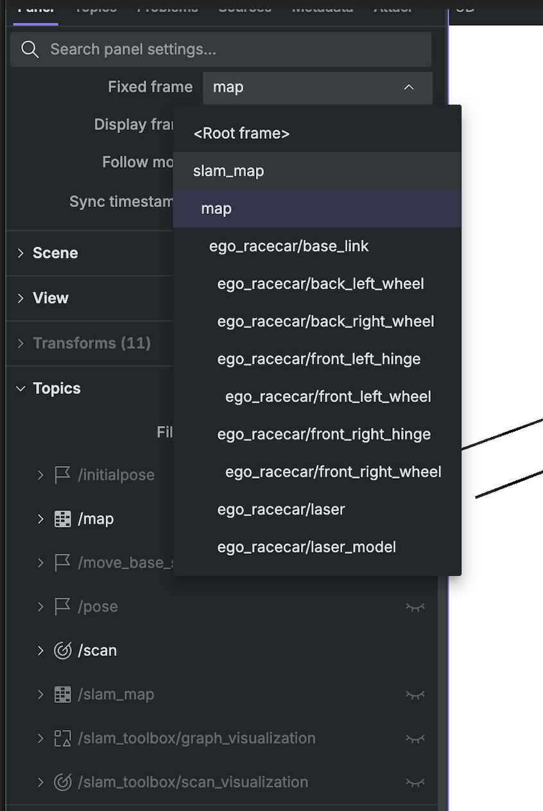
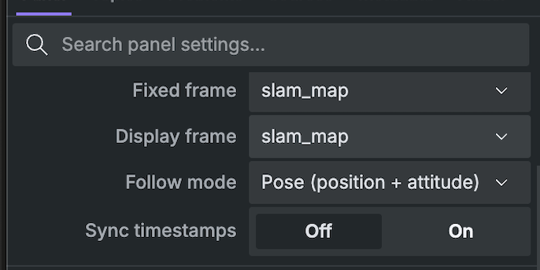
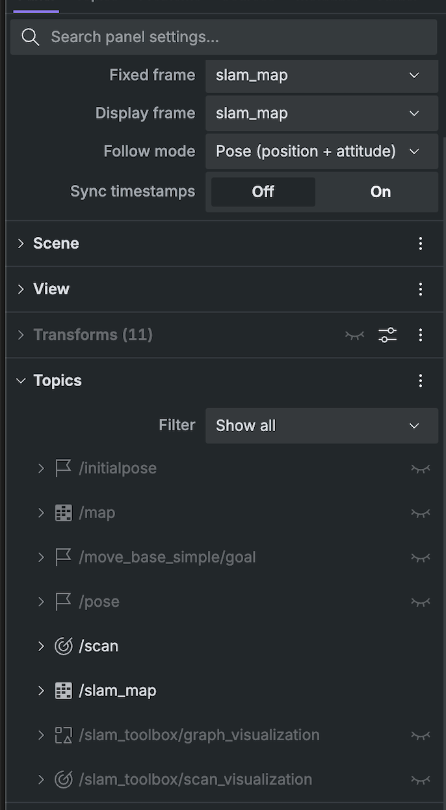

## Mapping Driving

### TF Systems

**Issue:** the car tracks its own motion by counting wheel turns and steering angle (dead reckoning). This is fast and smooth, but drifts over time from wheel slip, tire wear, and other real-world imperfections, so the tracked position slowly stops matching the car's true position. TF systems manage this offset, instead of one single number for the car's location. ROS keeps several different position estimates as separately named coordinate frames, so the one that always drifts (dead reckoning estimate or `odom` frame) can be corrected later without being thrown out or restarted.

**Frames and the tree**

- Every coordinate frame (`map`, `odom`, `base_link`, sensor frames) sits in one tree, and each frame has exactly one parent. (Set by [REP 105](https://www.ros.org/reps/rep-0105.html), the official ROS spec for robot frames.)
- Fixed parts on the car (sensor mounts) publish a static transform once, onto a topic called `/tf_static`. Dynamic things, like `odom → base_link`, publish continuously, onto a topic called `/tf`. Every message on either topic has the same shape: a parent frame, any number of child coordinate frames, and the rotation plus translation between them, sent as a `geometry_msgs/msg/transform_stamped` ([ROS 2 tf2 tutorials](https://docs.ros.org/en/humble/Tutorials/Intermediate/Tf2/Writing-A-Tf2-Listener-Cpp.html)).
- Any node can ask "where is X relative to Y" and tf2 chains the pieces together, using [tf2 tutorials, ROS 2 docs]

**Order**
`map` -> `odom` -> `base_link` -> sensors

- `base_link`: bolted to the chassis, doesn't move relative to the car (rear axle center).
- `odom`: a world-fixed frame used for dead reckoning. Drifts over time, but continuous ([REP 105](https://www.ros.org/reps/rep-0105.html)).
- `map`: another world-fixed frame tied to the saved track map. Accurate long term, but can jump when localization corrects it.
- Map and odom can't both attach straight to base_link. A frame can only have one parent, so they have to be stacked.


**Sensor frames (example: `laser_frame`)**

- Sensors only know the world in their own frame of reference. A LiDAR point returns a distance from a wall and its angle, which is measured from the sensor itself, in `laser_frame`. On its own, we cannot tell exactly where the point is relative to the car.
- When LiDAR is mounted, we measure exactly how close `laser_frame` sits relative to `base_link` (for example, 15cm forward of the axle, facing straight ahead), and publish that as a static transform. (This never changes since the components are bolted down.)
- Applying that transform is what allows us to make sense of the LiDAR readings, using the static transform as a frame of reference (ex. LiDAR scans 2m ahead of sensor -> 2.15m ahead of `base_link`). Specifically, it is a rigid body transform, a rotation and a translation, no stretching, since the sensor and chassis don't flex relative to each other ([ROS 2 tf2 tutorials](https://docs.ros.org/en/humble/Tutorials/Intermediate/Tf2/Writing-A-Tf2-Listener-Cpp.html)).
- Because `base_link` already chains up to `odom` and `map`, that same LiDAR point can then be expressed relative to either of those too. The LiDAR node never needs to know odometry or localization exist.
- `imu_frame` works the same way, a fixed offset to `base_link`, so IMU readings can be used in the car's own frame.

**Odometry (`odom` frame and `odom → base_link` transform)**

- Whatever node reads the wheels/VESC (plus IMU if fused) does two separate things with the result:
  1. Publishes it as data, a `nav_msgs/Odometry` message on a topic (`/odom`), carrying the robots pose and its velocity, for anything that wants the actual numbers, like an EKF or a logger ([nav_msgs/Odometry message](https://docs.ros.org/en/jazzy/p/nav_msgs/msg/Odometry.html)).
  2. Publishes the matching `odom → base_link` transform onto `/tf`, at the same rate. This transform represents the car's smooth, continuous trajectory based purely on dead reckoning, measuring how far it has traveled relative to its starting point (the fixed `odom` frame).

**Correcting Odom Drift (`map → odom`)**

- Because dead reckoning accumulates error over time, the `odom → base_link` position will eventually drift away from reality.
- To prevent the car from violently jerking to correct this error (would break continuous control loops), the `odom → base_link` transform is never snapped back to reality.
- Instead, a localization node (SLAM) calculates the exact amount of accumulated drift and publishes a `map → odom` transform. This acts as an offset, shifting the entire `odom` frame back to align with the real-world `map`, ensuring the final `map → base_link` chain is accurate while keeping local movement perfectly smooth.

- These two are easy to mix up, they usually come from the same node and the same numbers, but they do different jobs. The topic is data to read, the transform is for chaining coordinate frames. While purely reactive nodes (ftg) only need static sensor transforms, trajectory trackers that need to track the car's continuous movement in space rely on this odom transform.
- Reliable odometry is also what our TTC safety logic needs (see Safety above).

**Splitting up `map` and `odom`**

- Speed: localization updates slower (10 to 40Hz) than control needs (50 to 100+Hz). Splitting lets fast nodes work asynchronously with slow nodes.
- Safety: jumps only ever happen in map to odom. Odom to base_link never jumps, so PID and follow the gap never get destabilized mid turn.
- Simplicity: anything that wants the car's map position (costmap, raceline follower, RViz) just asks for it, and tf2 chains map, odom, and base_link together automatically.

**Debugging:** use `ros2 run tf2_ros tf2_echo` to show a live transform, and use `ros2 run rqt_tf_tree rqt_tf_tree` to see the whole tree for debugging purposes.

---

## Setting up SLAM & PF

**SLAM (Simultaneous Localization and Mapping)** uses LiDAR scans and TF transforms to build a 2D map while estimating the car's position. **Particle Filter (PF)** uses a known map, LiDAR, and odometry to estimate the car's position.

**References:**

- [SFU Racerbot Tutorial 5](https://github.com/sfu-racerbot/racerbot-docs/blob/main/notes/TUTORIAL-5.md)
- [SFU Racerbot Workspace](https://github.com/sfu-racerbot/racerbot_ws)
- [F1TENTH Simulator](https://github.com/f1tenth/f1tenth_gym_ros/tree/dev-humble)

### First-Time Setup (If Never Used SLAM/PF)

1. Install and open Docker Desktop.
2. Set up the [SFU Racerbot workspace](https://github.com/sfu-racerbot/racerbot_ws) following its README. Make sure port `8765` is forwarded for Foxglove.
3. Start your existing Docker container:

```bash
docker start -ai racerbot
```

4. Source the ROS 2 environment inside Docker:

```bash
cd /racerbot_ws
source /racerbot_ws/.venv/bin/activate
source /opt/ros/humble/setup.bash
source install/local_setup.bash
```

If the simulator or virtual environment has not been installed, follow the [SFU simulator setup guide](https://github.com/sfu-racerbot/racerbot-docs/blob/main/resources/F1TENTH_GYM_ROS.md) first.

#### Installing SLAM Toolbox

```bash
sudo apt-get update
sudo apt-get install -y ros-humble-slam-toolbox
```

#### Installing Particle Filter

Clone the dependencies into your workspace (**skip repositories already cloned**):

```bash
cd /racerbot_ws/src

git clone https://github.com/f1tenth/range_libc.git -b humble-devel
git clone https://github.com/f1tenth/particle_filter.git -b humble-devel
```

Install dependencies and build without CUDA:

```bash
cd /racerbot_ws
python3 -m pip install Cython
rosdep update
rosdep install -r --from-paths src --ignore-src --rosdistro humble -y
colcon build --packages-select range_lib --cmake-args -DWITH_CUDA=OFF
colcon build
source install/setup.bash
```

Edit `/racerbot_ws/src/particle_filter/config/localize.yaml` and make sure these parameters are set **under `particle_filter: ros__parameters:`**:

```yaml
scan_topic: "/scan"
odometry_topic: "/ego_racecar/odom"
range_method: "rm"
viz: 1
```

These settings use the simulator's LiDAR and odometry topics, CPU raycasting, and PF visualization.

---

### How to Start a Session

#### 1. Open Docker

Open Docker Desktop, then run in your computer's terminal:

```bash
docker start -ai racerbot
```

#### 2. Start tmux and Source ROS 2

Inside Docker:

```bash
cd /racerbot_ws
tmux
source /racerbot_ws/.venv/bin/activate
source /opt/ros/humble/setup.bash
source install/local_setup.bash
```

Use `Ctrl+B`, then `C` to open another tmux window. **Source the environment again in each new window.** Use `Ctrl+B`, then `W` to see all windows.

#### 3. Launch the Simulator

```bash
ros2 launch f1tenth_gym_ros gym_bridge_launch.py
```

Open [Foxglove](https://app.foxglove.dev/), select **Open Connection → Foxglove WebSocket**, and connect to:

```text
ws://localhost:8765
```

Import the supplied Foxglove layout from your local workspace:

```text
racerbot_ws/src/f1tenth_gym_ros/config/foxglove/gym_bridge_foxglove.json
```

#### 4. Launch Path Detection and Movement Node

Create a new tmux window, source ROS 2, then launch **your team's actual movement/path-detection node**. For example:

```bash
ros2 run YOUR_PACKAGE_NAME YOUR_NODE_EXECUTABLE
```

If your node is started using a launch file instead:

```bash
ros2 launch YOUR_PACKAGE_NAME YOUR_LAUNCH_FILE.py
```

**Replace the placeholders** with the package and executable (or launch file) used by your project (ftg, disparity extender, etc). Keep the node running during SLAM or PF.

---

### Running SLAM

#### Launch SLAM

Open another tmux window, source ROS 2, and run:

```bash
ros2 run slam_toolbox async_slam_toolbox_node --ros-args \
  -r __node:=slam_toolbox \
  --params-file /racerbot_ws/src/f1tenth_gym_ros/launch/slam/f1tenth_gym_online_async.yaml \
  -r map:=/slam_map \
  -p use_sim_time:=false
```

This uses the simulator-specific TF configuration and publishes the generated map to `/slam_map`, separate from the simulator's original `/map`.

#### Foxglove Setup

1. Open Foxglove's **3D panel** and open its settings.
2. Under **Fixed frame**, choose `slam_map` from the dropdown:



3. Confirm both **Fixed frame** and **Display frame** are set to `slam_map`:



4. Under **Topics**, show `/slam_map` and `/scan` and hide the simulator's original `/map` to see SLAM work in real time.



The new occupancy grid should fill in as the car moves through the environment. (Ensure movement node is still running)

#### Saving the Map

Once mapping is complete, open another **sourced** tmux window:

```bash
mkdir -p /racerbot_ws/src/mapping_output
ros2 run nav2_map_server map_saver_cli \
  -t /slam_map \
  -f /racerbot_ws/src/mapping_output/track_slam \
  --ros-args -p map_subscribe_transient_local:=true
```

This saves `track_slam.yaml` (map settings) and `track_slam.pgm` (occupancy grid image), which can be reused for localization.

---

### Running Particle Filter

#### Launch PF

Keep the simulator and movement node running. Stop SLAM first if mapping is complete, then run:

```bash
ros2 run particle_filter particle_filter --ros-args \
  --params-file /racerbot_ws/src/particle_filter/config/localize.yaml
```

This uses the simulator's existing map server and avoids launching a duplicate map server.

#### PF Visualization in Foxglove

1. Open the **3D panel**.
2. Set **Fixed frame** and **Display frame** to `map`.
3. Enable these topics:

| Topic                   |
| ----------------------- |
| `/map`                  |
| `/pf/viz/inferred_pose` |
| `/pf/viz/particles`     |
| `/scan`                 |

---

4. Use the **2D Pose Estimate** tool to publish to `/initialpose` and initialize the car's position and orientation.

**Expected Result:** Particles should concentrate around the estimated position and follow the car as it moves.

**Note:** In simulation, publishing to `/initialpose` can also reset the simulator's car position.

#### Checking PF Frequency

```bash
ros2 topic hz /pf/viz/inferred_pose
```

At least 30 Hz is a good standard.

#### Using a SLAM-Generated Map

By default, the PF command above uses the simulator's existing map. To use a SLAM-generated map, launch a separate map server with the saved `.yaml` file and redirect PF's map-service request to it.

---

### Quick Setup (if packages already installed)

1. Open Docker Desktop and run `docker start -ai racerbot`.
2. Start `tmux` and source the ROS 2 environment.
3. Launch `ros2 launch f1tenth_gym_ros gym_bridge_launch.py`.
4. Launch your project's movement/path-detection node.
5. Connect Foxglove to `ws://localhost:8765`.
6. Launch SLAM or PF using the commands above.
7. **SLAM:** Display `/slam_map`, explore the track, and save the map.
8. **PF:** Display `/map`, `/pf/viz/inferred_pose`, and `/pf/viz/particles`.


---


## 1. Open source implementation and architecture 

This implementation plan Is adapted from [`this repository`](https://github.com/CL2-UWaterloo/Raceline-Optimization), which generates an offline optimized race line using ordered track reference and boundary widths. It uses helper libraries to for spline generation, curvature optimization and velocity calculations (velocity calculations are not our main concern for now, we are focused more on the race line generation).


## 2. Algorithm

### Spline
A spline is a set of low degree polynomials (usually cubics) fit onto a path. 
- Polynomials must be be continuous to prevent any sharp turns and maintain a smooth track path.


### Architecture:
1. Centre line generation via. `generator.py`, this is the reference path.
2. Apply spline fitting onto the reference path (Ensuring that cubic functions are continuous across full path)
3. Optimize sideways offset from the reference to reduce curvature while ensuring that physical constraints and track boundaries are considered.
4. Using the new optimized offset spline, regenerate new waypoints on the new spline's optimized location.


### Step 1: 
After SLAM maps out the track, generate centre line waypoints with `generator.py`, this is the reference path.


### Step 2:
The [`spline_approximation.py`](https://github.com/CL2-UWaterloo/trajectory_planning_helpers/blob/fde6cee/trajectory_planning_helpers/spline_approximation.py) script interpolates the input and estimates a smooth spline onto our pre-generated waypoints (at centre line). It adjusts for reference displacement and reduces the centreline noise for further optimization.

Using [`calc_splines.py`](https://github.com/CL2-UWaterloo/trajectory_planning_helpers/blob/fde6cee/trajectory_planning_helpers/calc_splines.py), we can construct the actual piecewise cubic curves for the reference line.

```text
x_i(t) = a_i + b_i t + c_i t² + d_i t³
y_i(t) = e_i + f_i t + g_i t² + h_i t³
```

### Step 3:

To optimize the path, we use [`opt_min_curv.py`](https://github.com/CL2-UWaterloo/trajectory_planning_helpers/blob/fde6cee/trajectory_planning_helpers/opt_min_curv.py) to move reference points sideways and find a position for the spline such that curvature is minimized and path completion is fastest.

```text
optimized point = reference point + lateral offset × unit normal
```

A quadratic program chooses offsets to reduce a squared-curvature approximation. Corridor constraints subtract half the effective vehicle width from available left/right widths. 

### Step 4:
Finally to reconstruct the shifted points and resample (regenerate waypoints at optimized spline position) we use [`create_raceline.py`](https://github.com/CL2-UWaterloo/trajectory_planning_helpers/blob/fde6cee/trajectory_planning_helpers/create_raceline.py).

### Step 5 (future)
For now, we are focusing only on the waypoint generation, though the [`calc_vel_profile.py`](https://github.com/CL2-UWaterloo/trajectory_planning_helpers/blob/fde6cee/trajectory_planning_helpers/calc_vel_profile.py) script allows us to build a full velocity profile function for the optimized race line. The script uses curvature, lateral acceleration, motor acceleration, braking, drag, and maximum speed. Forward/backward passes account for acceleration and braking around the closed lap.

Finally, [F110 exporter](https://github.com/CL2-UWaterloo/Raceline-Optimization/blob/9290c5d/helper_funcs_glob/src/export_traj_race.py) writes `x,y,speed` and produces the csv for the optimized raceline. For now we can ignore the `speed` parameter as we will not be using it yet.


## 3. Implementation to `racerbot_a`

We can add Waterloo’s optimizer after our existing centreline generator. The optimizer runs offline after saving the SLAM map, then exports new waypoints for our C++ Pure Pursuit controller.

### Architecture:

1. Save the SLAM map as YAML and PNG/PGM.
2. Generate centreline waypoints and track widths using `generator.py`.
3. Run minimum-curvature optimization on the centreline.
4. Validate the optimized path against the original map.
5. Export the validated waypoints as a CSV.
6. Load the CSV into Pure Pursuit.

Mapping, localization, Pure Pursuit and braking continue running through ROS. The Python optimizer can run in a separate environment or container with pinned dependencies, keeping its dependencies separate from ROS 2 Humble.

### Centreline input

Our existing [`generator.py`](../src/waypoint_generator/waypoint_generator/generator.py) produces:

```text
x_m, y_m, w_tr_right_m, w_tr_left_m
```
These columns match the four-column input accepted by Waterloo’s [`import_track()`](https://github.com/CL2-UWaterloo/Raceline-Optimization/blob/9290c5d/helper_funcs_glob/src/import_track.py). All values are in metres. The widths describe the available space on each side of the reference point, before subtracting vehicle clearance.

This means we can reuse our current centreline generator instead of using Waterloo’s map-processing code.

### Pure Pursuit output

Our current [`PurePursuit::load_waypoints()`](../src/pure_pursuit_a/src/pure_pursuit_a_node.cpp) reads only `x,y`. Speed is calculated from steering, so we can first integrate the optimized path without adding waypoint speeds.

For future speed profile support, we would need to explicitly load `v_mps` and select or interpolate speed based on the car’s progress along the path. The CSV formats must have three columns, whereas our centreline file has **right track width**, not speed.

### Coordinates and path formatting

Before loading the optimized CSV, we need to check these things:

1.  **Loop closure:** (Waterloo's main pipeline adds a repeated endpoint, we must remove this.)
2.  **Driving direction:** Set the direction before optimization. If reversing an existing path, we must also swap left/right widths, as Waterloo's import reversal only reverses the rows.
3.  **Coordinate frame:** Pure Pursuit reads `/ego_racecar/odom` directly without transforming the pose. The pose and waypoint coordinates must use the same frame. Our simulator SLAM configuration uses `slam_map`.
### Integration changes


### Validation and braking

WE must also check the optimized path against the original occupancy map to ensure that the trackline is possible. We must consider the segments between waypoints and the vehicle footprint. A smooth spline alone does not guarantee wall clearance or a turn the car can physically follow.

Moreover, the offline optimizer does not avoid moving vehicles, if another car enters the path, our robot will continue to run the slowing and/or braking code of the runtime safety system.

